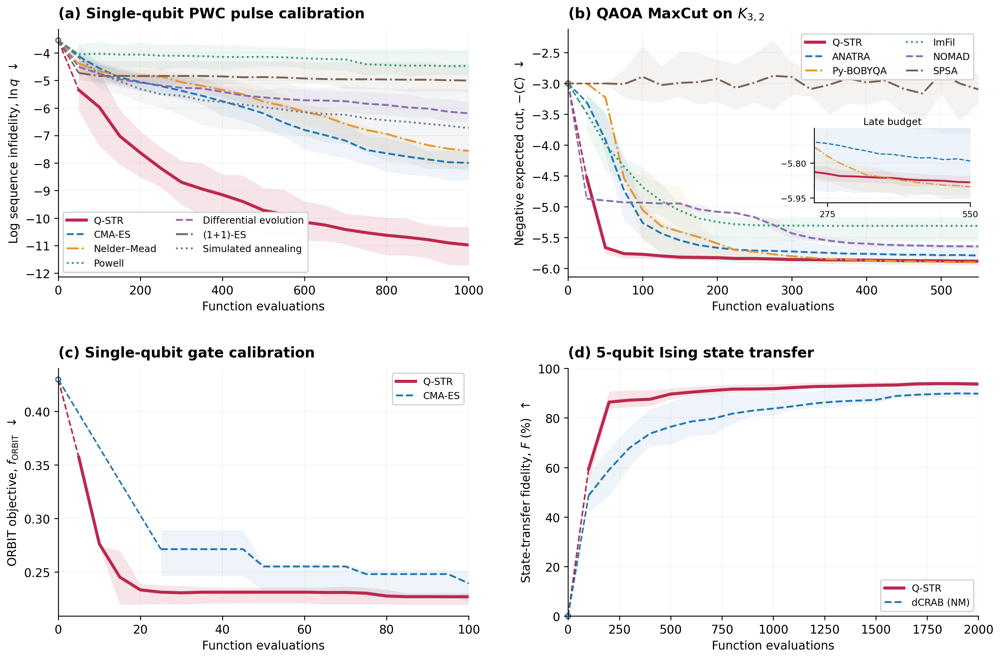

# Q-STR: Quantum Structured Trust-Region Optimization

A derivative-free optimizer for quantum parameter tuning, with four reproducible
quantum benchmarks and published reference data.

**[Download the complete v0.1.0 reproduction bundle](https://github.com/huwei0121/qstr/releases/download/v0.1.0/qstr-reproducibility-0.1.0.zip)** · [Release notes and checksums](https://github.com/huwei0121/qstr/releases/tag/v0.1.0)

Git仓库包含求解器、全部模型与基线、固定环境、30种子配置、逐种子质量数据和图表，可以安装、运行新实验和重画已有结果。418258次逐次查询数组保存在上方约217 MB的完整Release包中；运行存档轨迹的 `compare` 或获取全部数据时，请下载并解压完整包。下面的完整复现步骤以Release包为准。

本包包含 Q-STR 求解器、四个量子参数优化问题的物理模型、17个问题/算法组合、固定实验配置、所需第三方源码、逐次查询数据，以及统计和绘图程序。所有运行入口均使用随包代码，不依赖原研究仓库。复现对象是我们已经完成的四任务比较；各任务与来源论文的对应关系、公开材料缺失和已有重建差别见 docs 中的任务说明。

## 1. 环境与安装

使用 **64位 Python 3.10**。初次安装需要网络访问 Python 包索引；无需量子设备或GPU。已验证环境为 Windows x64。启动命令会建立独立虚拟环境并安装固定版本，完整物理环境以C³/TensorFlow的下载体积最大。安装程序不修改系统Python环境。

解压后进入包含 reproduce.py 的目录，先核验包内容：

~~~console
python reproduce.py verify
~~~

仅查看和重画已有结果：

~~~console
python reproduce.py setup --runtimes analysis
python reproduce.py plot --output outputs/reference
~~~

输出包含 four_problems.png、PDF、SVG、summary.json 和逐种子终点表 endpoints.csv。程序从510条逐种子记录重新计算17条曲线的均值和四分位带，不读取预先生成的图片。

随包 figures 目录已提供这些输出的预览，可在安装前直接查看。

安装全部模型和基线：

~~~console
python reproduce.py setup
~~~

若当前 python 不是3.10，可为 setup 增加 --python 指向3.10解释器。环境按用途分开：analysis用于统计绘图，pulse用于Pack/Ising，qaoa用于QAOA，gate用于C³。物理后端单独载入，绘图不导入TensorFlow或Qiskit。

Windows安装自动应用 requirements/locks 中经干净环境验证的完整依赖版本约束，避免间接依赖更新改变环境。每套环境还保存 installed-requirements.txt，记录实际安装结果。

## 2. 验证安装与运行全部实验

先运行17个组合的小预算检查：

~~~console
python reproduce.py run --config configs/smoke.json --output outputs/smoke --workers 2
python reproduce.py plot --input outputs/smoke --output outputs/smoke_figures
~~~

此配置使用一个专用测试种子、较小训练预算和较小独立验证集，仅检查软件、模型和记录链路。它不用于判断优化性能。

正式配置包括原30个种子、原预算和原基线参数。先查看计划，再执行：

~~~console
python reproduce.py run --config configs/full.json --plan
python reproduce.py run --config configs/full.json --output outputs/full --workers 2
python reproduce.py plot --input outputs/full --output outputs/full_figures
python reproduce.py compare --input outputs/full --output outputs/full_comparison.json
~~~

正式运行共510条：Pack210、QAOA180、C³60、Ising60。已保存的原批次实际共418258次目标函数评价；本次重跑会重新执行模型、抽样和优化。每个组合独立进程运行，并在开始前固定线性代数线程数。全部评价、推荐点和独立验证结果逐次保存。

compare逐项检查查询坐标、反馈、返回点及独立评价，与同问题、算法和种子的随包存档比较；数值有差异时保留结果并返回非零状态。小预算检查使用不同协议，不能拿它要求与正式预算轨迹一致。

可先选择单任务、单算法和单种子：

~~~console
python reproduce.py run --config configs/full.json --problems qaoa_maxcut --methods qstr --seeds 7098473 --output outputs/qaoa_single
~~~

中断后用相同参数增加 --resume。已经完成且配置和源码相同的运行会跳过；失败输出移入该运行的 attempts 子目录，随后重新执行。改变实验配置或源码应使用新输出目录。绘图排除已归档的尝试，记录当前失败和缺失数量；存在缺失时统计只描述已完成样本，不能冒称完整30种子结果。

## 3. 问题、预算和评价指标

| 问题 | 维数 | 每次评价 | 每条运行上限 | 算法 |
| --- | ---: | --- | ---: | --- |
| pulse_calibration | 82 | 40条新随机电路的精确概率 | 1000 | Q-STR、CMA-ES、NM、Powell、DE、(1+1)-ES、SA |
| qaoa_maxcut | 10 | 1000 shots | 550 | Q-STR、ANATRA、Py-BOBYQA、ImFil、NOMAD、SPSA |
| gate_calibration | 3 | 25条电路×1000 shots | 100 | Q-STR、CMA-ES |
| ising_state_transfer | 100 | 一次含随机耦合的传播 | 2000 | Q-STR、完整dCRAB/NM |

所有优化器只访问付费反馈。初始模型构造、复测和重新初始化均计费。推荐点先按优化器自身规则固定，再进行独立质量评价；离线真值不参与优化。图中依次显示 ln(电路失败概率)、负割期望、ORBIT失败率和状态转移保真度。色带为随机种子间25%—75%分位数，不是置信区间。零点只展示独立评价的初值；连接到第一个已有检查点的虚线是视觉引导，不补造中间数据。

详细模型、变量单位和基线参数：

- [Pack脉冲校准](docs/pulse.md)
- [QAOA MaxCut](docs/qaoa.md)
- [C³门校准](docs/gate.md)
- [Ising态转移](docs/ising.md)
- [数据结构与重画说明](docs/data.md)
- [软件验证与数值复现](docs/verification.md)

## 4. 目录与代码

~~~text
reproduce.py                安装、计划、运行、断点续跑、绘图
configs/                    原30种子配置与小预算检查配置
requirements/               各环境依赖和经验证的安装版本
src/qstr_benchmarks/         四个物理问题、基线适配和分析
solver/                     独立Q-STR求解器完整源码
third_party/                C³、QuOCS等固定上游源码与许可证
data/                       510条逐种子评价和418258次付费查询
figures/                    由随包数据生成的图与统计表
tests/                      物理模型、抽样协议和统计检查
validation/                 数值等价与干净环境验证摘要
MANIFEST.json               随包文件的SHA-256
~~~

新算法可接入相同目标函数并保留统一记录格式。正式Q-STR调用 solver 中的 qstr.minimize_with_preset；四任务不再转调旧研究驱动。通用求解器说明见 [solver/README.md](solver/README.md)。

Q-STR及本地实验代码采用 BSD 3-Clause。第三方代码保留原许可证和归属，详见 [THIRD_PARTY_NOTICES.md](THIRD_PARTY_NOTICES.md)。
